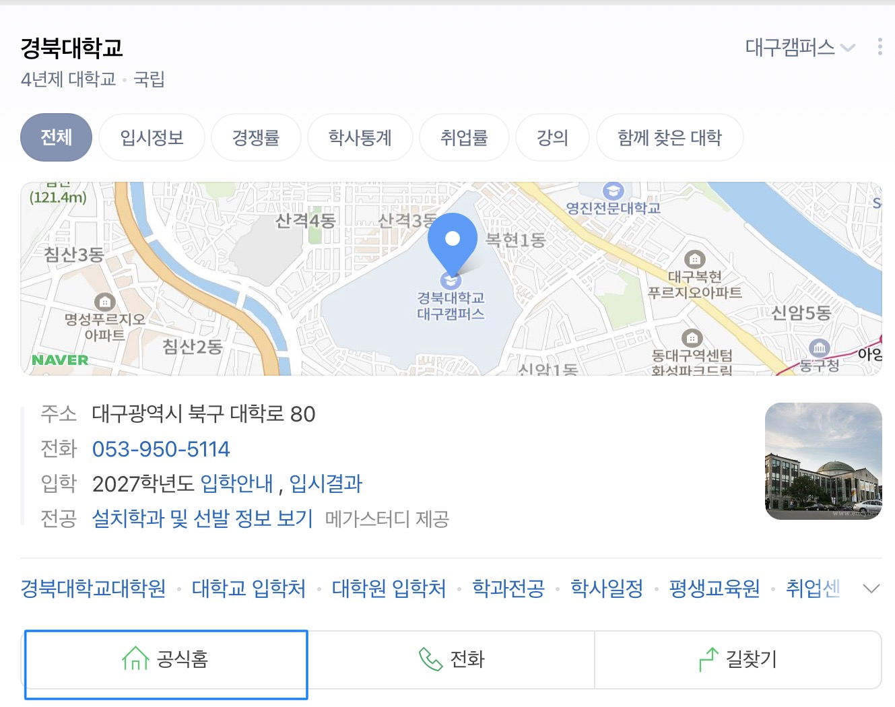

# 신입생 메뉴얼 👩‍🏫
> 처음 만나는 경북대학교 생활, 이 가이드북 하나로 시작하기
## 📌 프로젝트 소개
본 프로젝트는 경북대학교 신입생들의 원활한 대학 생활 적응을 돕고
재학생들이 직접 경험한 유용한 정보와 생활 꿀팁을 제공하기 위해 제작한 가이드북입니다.

---
## 📁 목차 
### 1. [학교 교내 식당 및 맛집](yuna/yuna.md)
- 경북대학교 교내 식당
- 경북대학교 주변 맛집
- 식당 이용 참고사항

### 2. [주요 편의시설 안내](seoyoon/seoyoon.md)
- 중앙도서관
- 진로취업과
- 교내 우편취급국
- 교내 은행
- 복지관 쇼핑플라자와 기타 편의시설
- 이용 전 확인할 사항

### 3. [대학생 무료 프로그램 안내](donglyeol/student-free-programs.md)
- 학생용 MATLAB
- Gemini for Student
- 학생용 Notion 무료 업그레이드
- 학생을 위한 무료 Microsoft 365

### 4. [신입생을 위한 졸업요건 확인 및 수강신청 방법](jaeseop/jaeseop.md)
- 졸업요건
- 수강 신청 방법
- 수강 정정기간 및 수강 취소 기간
- 장학금 최소요건 확인방법

### 5. [경북대학교 캠퍼스 길찾기 가이드](youngmin/youngmin.md)
- 경북대학교 캠퍼스 개요
- 단과대학별 위치 및 구역 안내
- 주요 버스정류장 및 운행 노선
- 버스정류장별 캠퍼스 접근 방법
- 목적지별 추천 이동 경로

### 6. [경북대학교 기숙사](goeun/goeun.md)
- 경북대학교 대구캠퍼스 생활관 현황
- 출입시간
- 상벌점 제도
- 기숙사 식당 이용 안내
___
## 이용안내

본 메뉴얼은 경북대학교 신입생들이 대학 생활에 필요한 정보를 쉽게 찾아볼 수 있도록 구성되어 있습니다

- 목차를 통해 관심 있는 항목을 클릭하면 자세한 내용을 확인할 수 있습니다
- 식당 및 편의시설 이용 정보와 수강신청 방법 등을 참고하여 대학 생활에 활용할 수 있습니다
- 기숙사와 캠퍼스 이동 정보를 확인하여 학교생활에 필요한 정보를 얻을 수 있습니다
  
## 메뉴얼 활용 팁 

- 학사 일정과 수강신청 기간은 매 학기 달라질 수 있으므로 학교 공지사항을 확인하세요
- 시설 운영시간과 프로그램 지원 조건은 변경될 수 있으므로 이용 전 공식 홈페이지에서 확인하세요
- 졸업요건과 장학금 기준은 개인 및 학과에 따라 다를 수 있으므로 본인에게 해당하는 기준을 확인하세요
- 처음 방문하는 시설은 위치와 운영시간을 미리 확인하면 더욱 편리하게 이용할 수 있습니다

## 안내 사항

본 메뉴얼은 대학 생활에 도움을 주기 위한 참고 자료입니다

학사 제도와 시설 운영 정보는 변경될 수 있으므로 중요한 사항은 반드시 경북대학교 공식 공지사항 및 담당 부서를 통해 확인하시기 바랍니다
  
## 👥 팀원 역할 분담

| 팀원 | 담당 내용 |
|:---:|---|
| 강윤아 | 학교 교내 식당 및 맛집 안내 작성|
| 이서윤 | 주요 편의시설 안내 (도서관, 진로취업센터 등) 작성 |
| 이동렬 | 대학생 무료 프로그램 안내 작성 및 발표 담당 |
| 박재섭 | 졸업 요건 확인 및 수강 신청 방법 안내 작성 |
| 정용민 | 경북대학교 길찾기 가이드 작성 |
| 서고은 | 경북대학교 기숙사 및 README 파일 작성 |

## 참고자료 및 출처

본 메뉴얼은 경북대학교 신입생의 대학 생활에 필요한 정보를 제공하기 위해 작성되었습니다

1. [경북대학교 공식 홈페이지](https://www.knu.ac.kr/)
2. 경북대학교 학사 관련 공지사항
3. 각 시설 및 프로그램의 공식 안내 자료

     **경북대학교에 대한 추가 궁금 사항은 공식 홈페이지를 통해 확인해 보세요**

