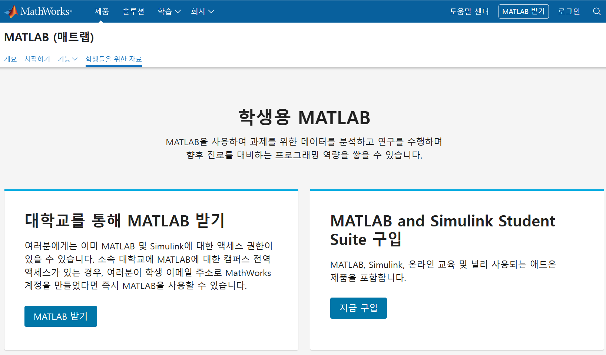

# 대학생 무료 프로그램 안내

대학생이라면 학업과 과제 수행에 유용한 다양한 프로그램을 무료로 이용할 수 있다. 하지만 이러한 혜택을 모르거나, 이용 방법을 몰라 활용하지 못하는 경우가 많다.

이 글에서는 학생들이 놓치기 쉬운 무료 소프트웨어와 학생 지원 혜택의 이용 조건과 가입 방법을 소개하고자 한다.

## 목차

1. [학생용 MATLAB](#1-학생용-matlab)
2. [Gemini for Student](#2-gemini-for-student)
3. [학생용 Notion 무료 업그레이드](#3-학생용-notion-무료-업그레이드)

---

## 1. 학생용 MATLAB

- [1.1 MATLAB이란?](#11-matlab이란)
- [1.2 학생용 MATLAB 무료 이용 조건](#12-학생용-matlab-무료-이용-조건)
- [1.3 학생용 MATLAB 가입 방법](#13-학생용-matlab-가입-방법)

---

### 1.1 MATLAB이란?

MATLAB(Matrix Laboratory)은 수치 계산, 데이터 분석, 알고리즘 개발 및 시각화 등을 수행할 수 있는 프로그래밍 환경이다. 행렬과 배열을 기반으로 다양한 수학적 계산을 간편하게 처리할 수 있으며, 공학 및 과학 분야에서 널리 활용된다.

**주요 활용 분야**
- **수치 계산:** 행렬 연산, 방정식 풀이, 미적분 등
- **데이터 분석:** 데이터 처리 및 통계 분석
- **시각화:** 2차원 및 3차원 그래프 생성
- **시뮬레이션:** 시스템 모델링 및 동작 분석
- **알고리즘 개발:** 반복 계산 및 자동화 작업

MATLAB은 특히 전기·전자공학, 기계공학, 컴퓨터공학 등 다양한 공학 분야에서 활용되며, 여러 기능을 제공하는 툴박스(Toolbox)를 통해 특정 분야의 문제도 효율적으로 해결할 수 있다.

다만 MATLAB은 상용 소프트웨어이므로 일반적으로 라이선스가 필요하다. 하지만 대학의 라이선스 제공 여부나 학생용 라이선스 조건에 따라 학생들도 MATLAB을 무료로 이용할 수 있다.

### 1.2 학생용 MATLAB 무료 이용 조건

학생이 MATLAB을 무료로 이용할 수 있는 대표적인 방법 중 하나는 소속 대학교에서 제공하는 **캠퍼스 라이선스(Campus-Wide License)** 를 이용하는 것이다.

캠퍼스 라이선스란 대학과 MathWorks가 계약을 맺어 해당 대학의 구성원들이 MATLAB 및 계약에 포함된 관련 제품을 이용할 수 있도록 제공하는 라이선스이다. 대학이 이 라이선스를 도입하면 계약 범위와 이용 조건에 따라 학생, 교직원 등이 MATLAB을 무료로 사용할 수 있다.

따라서 모든 대학생이 별도의 비용 없이 MATLAB을 이용할 수 있는 것은 아니다. 소속 대학교가 MathWorks와 캠퍼스 라이선스 계약을 체결했는지, 그리고 해당 계약에 학생의 이용 권한이 포함되어 있는지 확인하고 소속 대학교 메일을 통해 인증하여야 한다.

**경북대학교의 경우 정보화본부 홈페이지를 통해 계약 소프트웨어 목록을 확인할 수 있다.**
[경북대학교 계약 소프트웨어 목록](https://home.knu.ac.kr/HOME/knuuicc/sub.htm?nav_code=knu1624451652)

### 1.3 학생용 MATLAB 가입 방법

Campus-Wide License 계약이 체결된 대학교에 재학 중이라면, 소속 대학교에서 제공하는 라이선스를 통해 MATLAB을 무료로 이용할 수 있다. 먼저 대학교 홈페이지에서 발급받은 학교 이메일 주소를 준비한 후, MathWorks 공식 홈페이지에 접속하여 계정을 생성한다. 기존에 MathWorks 계정이 있다면 새로 가입할 필요 없이 학교 이메일 주소와 계정을 연결하거나 대학교 소프트웨어 담당자, 캠퍼스 포털에서 받은 활성화 키(Activation key) 또는 라이선스 번호를 입력하여 캠퍼스 라이선스를 연결하는 방법으로 이용할 수도 있다.

계정 생성 시에는 반드시 소속 대학교의 이메일 주소를 사용해야 하며, 학교에서 별도의 MATLAB 전용 포털을 제공한다면 해당 포털을 통해 가입 및 로그인을 진행하는 것이 좋다. 학교 이메일 주소가 해당 대학의 Campus-Wide License와 연결되면, 별도의 개인용 라이선스를 구매하지 않고도 계약 범위에 포함된 MATLAB 제품을 이용할 수 있다.

가입 및 라이선스 연결이 완료되었다면 MathWorks 홈페이지에서 MATLAB을 다운로드하여 PC에 설치하거나, 별도의 설치 과정 없이 MATLAB Online을 통해 웹 브라우저에서 바로 사용할 수 있다. 다만 학교마다 인증 방식과 제공 절차가 다를 수 있으므로, 계정 생성 후에도 MATLAB 이용 권한이 확인되지 않는다면 대학교의 소프트웨어 지원 안내를 확인하는 것이 좋다.

> 학생용 MATLAB 가입 화면이다. 'MATLAB 받기'를 통해 가입을 시작할 수 있다.

---
## 2. Gemini for Student
- [2.1 Gemini란?](#21-gemini란)
- [2.2 Gemini for student 무료 이용 조건](#22-gemini-for-student-무료-이용-조건)
- [2.3 Gemini for student 가입 및 혜택 신청 방법](#23-gemini-for-student-가입-및-혜택-신청-방법)
- [2.4 Gemini 무료 버전과 유료 혜택 비교](#24-gemini-무료-버전과-유료-혜택-비교)
---
### 2.1 Gemini란?

Gemini는 Google에서 개발한 생성형 인공지능(AI) 서비스로, 사용자의 질문에 답변하고 문서를 작성하거나 정보를 분석하는 등 다양한 작업을 수행할 수 있다. 텍스트뿐만 아니라 이미지, 음성, 동영상 등의 정보를 처리할 수 있으며, 학습이나 업무에 필요한 정보를 얻는 데 활용할 수 있다.

**Gemini의 모델 종류**

Gemini는 사용 목적과 작업의 복잡도에 따라 서로 다른 모델을 제공한다. 주요 모델은 다음과 같다.

- **Gemini Flash-Lite:** 빠른 응답 속도와 효율성을 중시하는 모델로, 간단한 질문이나 일상적인 작업에 적합하다.
- **Gemini Flash:** 응답 속도와 성능의 균형을 갖춘 모델로, 일반적인 질문과 정보 정리 등 다양한 작업에 활용할 수 있다.
- **Gemini Pro:** 복잡한 문제 해결, 심층적인 분석 및 프로그래밍과 같이 높은 수준의 추론이 필요한 작업에 적합하다.
- **Gemini Argon:** 복잡한 작업을 위한 고성능 추론 모델로, 여러 단계에 걸친 문제 해결과 전문적인 분석에 활용할 수 있다.

Gemini는 대학생들이 강의 내용을 정리하거나 과제를 준비하고, 프로그래밍 및 전공 공부를 진행할 때 유용하게 활용할 수 있다. 또한 Google의 다른 서비스와 연계되는 기능을 통해 작업 효율을 높일 수도 있다.

다만 Gemini가 제공하는 답변에는 부정확한 정보가 포함될 수 있으므로, 과제나 보고서에 활용할 때는 공식 자료와 신뢰할 수 있는 출처를 통해 내용을 검증하는 것이 중요하다.

### 2.2 Gemini for student 무료 이용 조건

Google은 일정 자격 요건을 충족하는 대학생을 대상으로 Google AI Plus 학생 요금제를 1년간 무료로 이용할 수 있는 혜택을 제공한다. 신규 사용자뿐만 아니라 2025년 AI Pro 체험판이 만료된 학생도 혜택을 이용할 수 있다. 해당 혜택은 만 18세 이상의 대학생을 대상으로 하며, 신청 과정에서 학생 신분 인증 절차를 완료해야 한다.

따라서 만 18세 이상이라는 연령 조건뿐만 아니라, 대학생 자격을 충족하고 Google에서 요구하는 인증 절차를 통과해야 무료 혜택을 이용할 수 있다. 또한 가입 시 유효한 결제 수단을 등록해야 하며, 무료 이용 기간이 종료되면 유료 구독 요금이 자동으로 청구될 수 있으므로 구독 조건을 확인하는 것이 중요하다.

신청 가능 여부와 자세한 이용 조건은 아래 공식 페이지에서 확인할 수 있다.

- [Gemini for student 학생 혜택 신청 및 안내](https://gemini.google/kr/students/?hl=ko)

### 2.3 Gemini for student 가입 및 혜택 신청 방법

학생용 Gemini 혜택을 신청하면 자격 요건을 충족하는 대학생은 Google AI Plus 요금제를 1년간 무료로 이용할 수 있다. 신청을 위해서는 개인 Google 계정과 학생 신분 인증이 필요하며, 유효한 결제 수단을 등록해야 한다. 

#### 1. Google 계정 준비

Gemini를 이용할 개인 Google 계정을 준비한다. 학교에서 발급한 이메일 주소는 학생 신분 인증에 활용할 수 있으므로, 학교 이메일 계정도 사용할 수 있는 상태인지 확인한다.

#### 2. 학생 혜택 신청 페이지 접속

아래 공식 페이지에 접속한다.

- [Gemini for student 혜택 신청 페이지](https://gemini.google/kr/students/?hl=ko)

페이지에서 **무료로 학생 요금제 신청하기** 버튼을 클릭한다.

#### 3. Google 계정으로 로그인

안내에 따라 개인 Google 계정으로 로그인한다. 학생 혜택 신청에 사용하는 계정이 실제로 혜택을 이용할 계정인지 확인한다.

#### 4. 학생 신분 인증

신청 페이지의 안내에 따라 학생 인증을 진행한다. 일반적으로 SheerID 등의 인증 절차에서 학교 정보와 학생 신분을 확인하며, 필요한 경우 학교 이메일이나 재학 증빙 자료를 제출해야 할 수 있다.

- 소속 대학 또는 대학원을 정확하게 선택한다.
- 학교 이메일 주소 등 요청된 정보를 입력한다.
- 추가 서류가 요청되면 안내에 따라 제출한다.
- 인증이 완료되었는지 확인한다.

인증 방법과 요구 자료는 학교 및 개인의 상황에 따라 달라질 수 있다.

#### 5. 무료 학생 요금제 신청 및 결제 정보 등록

학생 인증이 완료되면 신청 페이지에 표시되는 혜택과 이용 약관을 확인하고 구독 절차를 완료한다. 가입 과정에서 유효한 결제 수단을 등록해야 할 수 있다.

무료 이용 기간, 적용 요금제 및 자동 갱신 조건을 반드시 확인한다.

#### 신청 시 주의 사항

- 학생 혜택은 만 18세 이상의 자격 요건을 충족하는 대학생을 대상으로 하며, 나이만 충족한다고 자동으로 제공되는 것은 아니다.
- 신청 기간은 **2026년 12월 31일까지**로 안내되어 있으므로, 신청 전에 공식 페이지에서 최신 조건을 확인한다.
- 무료 이용 기간이 끝나면 유료 구독으로 자동 갱신되어 요금이 청구될 수 있다. 계속 이용할 계획이 없다면 갱신일 전에 취소한다.

### 2.4 Gemini 무료 버전과 유료 혜택 비교

Gemini는 Google 계정으로 무료 이용할 수 있지만, Google AI Plus 요금제를 이용하면 AI 기능의 사용 한도가 높아지고 클라우드 저장 공간과 추가 기능을 제공받을 수 있다. 특히 자격 요건을 충족하는 대학생은 Google AI Plus 학생 혜택을 통해 1년간 무료로 이용할 수 있다.

#### 무료 버전과 Google AI Plus 비교

| 구분 | 무료 버전 | Google AI Plus |
|---|---|---|
| 월 요금 (한국 기준) | 0원 | 월 7,500원~11,000원(플랫폼,시기별 변동) |
| 사용량 한도 | 표준 제한 (5시간 단위 갱신) | 무료 플랜 대비 2배 높은 사용 한도 |
| 동영상 생성(Veo 등) | 이용 불가 | 이용 가능 |
| Google flow 크레딧 | 없음 | 월 200 크레딧 제공 |
| 클라우드 저장 공간 | 15GB(기본 구글 계정 용량) | 200GB ~ 400GB |

## 3. 학생용 Notion 무료 업그레이드
