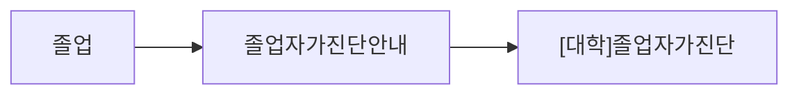
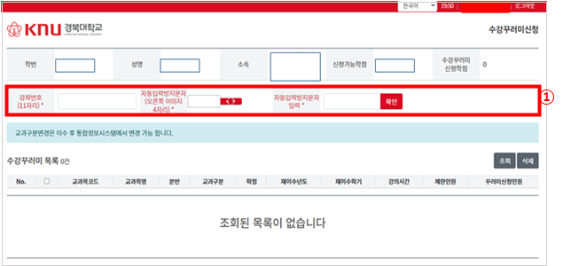
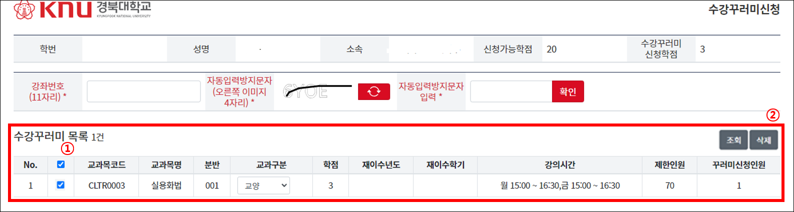

# 신입생을 위한 졸업 요건 확인 및 수강 신청 방법!  
## 목차  
1. 졸업 요건
* 졸업 요건 확인 방법  
* 졸업 요건에 쓰인 단어의 의미  
2. 수강 신청 방법  
* 수강꾸러미
* 과목코드를 이용한 수강신청 방법  
3. 수강 정정기간 및 수강 취소 기간  
4. 장학금 최소요건 확인방법  
----
### 1. 졸업 요건  
#### 졸업 요건 확인 방법  
각 학부마다 졸업 요건이 다르다. 따라서 각 [학부 홈페이지](https://www.knu.ac.kr/wbbs/wbbs/contents/index.action?menu_url=edu/school01&menu_idx=250)에 접속하여 학과공지를 **반드시** 확인해야 한다.  

**\[대학\]졸업자가진단**프로그램은 학교에서 공식 제공하는 프로그램으로, 아직 대학생활에 적응하지 못한 새내기들부터 곧 졸업할 졸업생들까지도 유용하게 사용할 수 있는 프로그램이다.  
\[대학\]졸업자가진단 프로그램을 이용하기 위해서는 [경북대학교 차세대 통합정보시스템](https://knuin.knu.ac.kr/webview/main/Main.knu)에서 다음과 같은 순서로 접속하면 이용할 수 있다.  

![[대학]졸업자가진단](통합정보_졸업요건자가진단프로그램.png)
정상적으로 접속했다면 위와 같은 창이 보이는데 여기서 **조회**버튼을 눌러주면 여러가지 정보를 확인할 수 있다. 이 프로그램에서 확인해야 할 것은 **학년\/분반**, **교육과정년도**, **상담횟수**, **수리*기초과학 이수학점 면제여부**, **총학점의 기준정보**, **평점평균** 이다.  
  
#### 졸업 요건에 쓰인 단어의 의미  
* 학년/분반 : 현재 학년과 분반이다. 학년과 분반에 따라 들을 수 있는 수업과 아닌 수업이 나뉠 수 있으며, 경우에 따라서는 장학금 대상 제외같은 패널티가 있을 수 있다.
* 교육과정년도 : 모든 졸업 요건의 기준은 '교육과정년도'이다. 예를 들어 2022학년도 입학생의 경우, 졸업할 때 까지 2022학년도 입학생 대상의 졸업요건에만 해당하며, 이후 바뀌는 졸업요건의 경우 특별한 공지가 없다면 적용받지 않는다.
* 상담 횟수 : 지도교수 상담 횟수를 의미한다. 졸업을 위해서 필요한 만큼 진행해야 하며, 상담이 가능한 기간은 교수님마다 다르므로 학과공지를 항상 확인하여 신청하도록 하자.
* 수리 \* 기초과학 이수학점 면제여부 : 수리 \* 기초과학을 반드시 이수해야하는 학년이 생김에 따라, 이에 해당하지 않는 이전 교육과정년도생들을 구분하기 위해 만들어진 듯 하다.
* 총학점의 기준정보 : 총학점이란 졸업을 위해 채워야 하는 학점을 의미하며, 전공과 교양학점 전부를 합친 학점이다. 이외에도 반드시 확인해야 할 것은 **전공학점**, **교양학점**과 각 **분류별 교양학점**이다. 각 분류별로 달성해야하는 최소 학점과 최대 학점이 나뉘므로 잘 확인하도록하자.
* 평점평균 : 최소 평점 평균이다. 이수한 학점의 평균을 냈을 때 달성해야 하는 최소 수치이며, 정상적으로 학교 생활을 한다면 걸릴 일이 없을 정도로 낮으므로 걱정할 필요는 없다.

### 2. 수강 신청 방법  
[수강 신청](https://sugang.knu.ac.kr/login.knu)과 관련한 모든 일정은 수강 신청 한 달 전 즈음에 **학과 공지**로 올라오므로 **반드시** 확인하도록 하자.  

#### 수강꾸러미  
수강꾸러미는 미리하는 수강신청 이라고 생각하면 편하다. 수강꾸러미는 **선착순이 아니며** 시간이 겹치거나 수강가능학점을 벗어나지 않는 한 계속 담을 수 있다. 수강꾸러미가 확정된 후 수강가능 인원보다 같거나 적은 수의 인원이 수강꾸러미에 담은 교과목의 경우 **자동으로 수강신청**되므로 만약 마음이 바뀌었다면 **수강신청날에 직접 삭제**해 줘야한다.  

  
  
수강신청 사이트에 접속하여 로그인 하면 다음과 같은 화면이 뜨는데, 여기서 원하는 과목의 코드와 보안 코드를 입력한 뒤 조회를 누르면 해당 과목이 아래의 목록에 뜬다.  
신청을 누르면 수강꾸러미에 담기는 것을 확인할 수 있다.

#### 과목코드를 이용한 수강신청 방법  
### 3. 수강 변경 및 수강 정정 기간  
### 4. 장학금 최소요건 확인방법  
