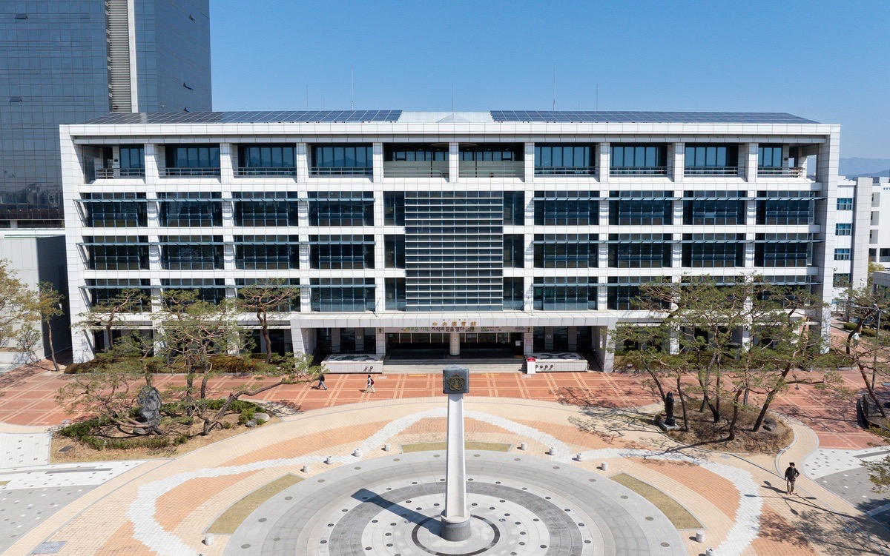
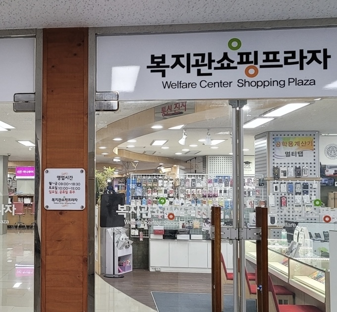

# 주요 편의시설 안내

## 목차

1. 중앙도서관
2. 진로취업과
3. 교내 우편취급국
4. 교내 은행
5. 복지관 쇼핑플라자와 기타 편의시설
6. 이용 전 확인할 사항

## 1. 중앙도서관

중앙도서관은 도서와 학습 자료를 이용하고 개인 공부를 할 수 있는 시설이다. 과제에 필요한 책을 찾을 때는 도서관 홈페이지에서 자료를 검색한 뒤, 소장 위치와 대출 가능 여부를 확인하면 된다. 책은 서가에서 직접 찾아 무인대출기 또는 대출실에서 빌릴 수 있다.

일반적인 학부 재학생의 대출 기준은 최대 10권, 14일이다. 대출할 때는 본인의 학생증이나 도서관 모바일 이용증 등이 필요하며, 다른 사람을 대신한 대출은 불가능하다.
빌린 책은 반납 예정일까지 대출실이나 무인반납기에 반납해야 한다. 지정도서 등 일부 자료에는 별도의 대출 조건이 적용되므로 확인이 필요하다.

도서관은 종이책뿐 아니라 전자책도 제공한다. 도서관 홈페이지나 앱을 이용하면 전자책을 검색하고 대출할 수 있어 직접 방문하기 어려운 날에도 활용할 수 있다. 신입생은 도서관을 시험기간에만 이용하기보다 평소 과제 자료를 찾거나 공강 시간을 활용하는 공간으로 알아두면 좋다.
전자책은 도서관 홈페이지에 로그인한 뒤 ‘검색 → eBook → 통합전자책’에서 이용할 수 있다. 모바일에서는 경북대학교 도서관 앱에 로그인한 뒤 ‘국내eBook → 전자책’으로 접속하면 된다.

### 열람실 이용

개인 공부를 위한 열람실은 신관 지하 1층과 2~4층에 마련되어 있다. 신관 1층 S-Lounge에는 노트북을 이용할 수 있는 좌석도 있어 이용 목적에 맞는 공간을 선택할 수 있다.

열람실 좌석은 경북대학교 도서관 앱이나 도서관 내 좌석 배정용 키오스크에서 배정받을 수 있으며, 홈페이지에서는 예약할 수 없다. 키오스크는 구관 1층과 신관 1층·3층에 설치되어 있다. 앱으로 입장 전에 좌석을 임시 배정받았다면 15분 이내에 출입 게이트 인증을 해야 배정이 확정된다. 좌석별 이용시간과 연장 가능 횟수는 다르므로 배정 시 확인해야 하며, 계속 이용하려면 이용시간이 끝나기 전에 연장해야 한다. 이용을 마치면 앱이나 키오스크에서 반드시 좌석을 반납해야 한다.

### 층별 주요 시설

구관은 자료 검색과 대출, 신관은 개인 학습을 위한 열람실 이용을 중심으로 살펴보면 편리하다. 구관과 신관의 층별 주요 시설은 다음과 같다.

| 위치 | 주요 시설 |
| --- | --- |
| 구관 지하 1층 | 보존자료실 |
| 구관 1층 | 대출실, 독서·휴식 공간, PC·노트북 이용 공간 등 |
| 구관 2층 | 인문학자료실, 어문학자료실 |
| 구관 3층 | 학위논문실, 연속간행물실, 스터디라운지 등 |
| 구관 4층 | 사회과학자료실, 자연과학자료실 등 |
| 구관 5층 | 개인문고, 고서실 등 |
| 신관 지하 1층·2~4층 | 열람실 |
| 신관 1층 | S-Lounge: 노트북 좌석, 휴식·토론 공간 등 |

### 이용 전 확인사항

자료실과 열람실은 운영시간이 서로 다르며, 학기 중·방학·시험기간에 따라 이용시간이 달라질 수 있다. 공사나 시설 점검으로 일부 공간이 임시 휴실할 수도 있으므로, 방문 전 도서관 홈페이지의 이용시간과 공지사항을 확인하는 것이 좋다.

### 참고 자료

- [경북대학교 도서관 홈페이지](https://kudos.knu.ac.kr/pages/)
- [중앙도서관 층별 안내](https://kudos.knu.ac.kr/pages/sub.htm?nav_code=kud1642726244)
- [신관 시설 안내](https://kudos.knu.ac.kr/pages/sub.htm?nav_code=kud1641547366)
- [좌석 이용 안내](https://kudos.knu.ac.kr/pages/sub.htm?nav_code=kud1641896531)
-  [도서 대출·반납 안내](https://kudos.knu.ac.kr/pages/sub.htm?nav_code=kud1642678074)
- [전자책 이용 안내](https://kudos.knu.ac.kr/pages/sub.htm?nav_code=kud1641542426)

## 2. 진로취업과

### 위치와 주요 기능

진로취업과는 복지관 학생동 4층 JOB PLAZA에 있으며, 학생의 진로 탐색과 취업 준비를 지원한다. 전공과 관련된 진로를 알아보거나 대학생활 중 필요한 경험을 계획할 때 활용할 수 있다.

주요 업무는 다음과 같다.

- 진로·취업 상담
- 취업정보 제공 및 진로·취업지원 교육 프로그램 운영
- 현장실습교육과정 운영
- 신입생 진로적성검사 및 진로탐색수업 운영

**기본 정보**

- 위치: 복지관 학생동 4층 JOB PLAZA
- 진로·취업 문의: 053-950-6064~6065
- 현장실습 문의: 053-950-6067~6068
- 홈페이지: [경북대학교 진로취업과](https://knujob.knu.ac.kr/)

### 신입생 활용 팁

진로취업과는 졸업을 앞둔 학생만 이용하는 곳이 아니다. 신입생도 자신의 관심 분야를 정리하고, 전공과 연결되는 진로를 탐색하는 데 활용할 수 있다.

전공 선택을 고민하거나 대학생활 동안 어떤 경험을 쌓을지 막막하다면, 홈페이지에서 진로 상담과 프로그램 안내를 살펴보는 것이 좋다.

### 프로그램 신청 전 확인사항

관심 있는 프로그램을 발견하면 다음 사항을 확인한다.

- 신청 대상: 자신의 학년과 참여 조건에 맞는지
- 접수 기간: 신청 마감일이 언제인지
- 참여 방식: 대면 또는 비대면으로 진행되는지
- 운영 일정: 수업 및 다른 활동과 시간이 겹치지 않는지

모든 프로그램이 신입생을 대상으로 하는 것은 아니므로, 개별 공지의 신청 조건을 확인한 뒤 신청한다. 상담을 이용할 때도 예약 필요 여부와 신청 방법을 먼저 확인한다.

**참고 자료**

- [경북대학교 진로취업과 조직도 및 연락처](https://www.knu.ac.kr/wbbs/wbbs/user/organChart/view.action?menu_idx=21&organChart.content_url=org01_knujob)

## 3. 교내 우편취급국

### 위치와 이용 목적

경북대학교 대구캠퍼스 우편취급국은 복지관 2층에 있다. 외부 기관에 서류를 보내거나 우편 제출이 필요한 자료를 발송할 때 활용할 수 있다.

**기본 정보**

- 위치: 복지관 2층
- 문의: 053-955-5281

**참고 자료**

- [북대구우체국 관할우체국 안내](https://kpic.koreapost.go.kr/702/subIndex/3287.do)
- [경북대 신문 「어서와, 경북대는 처음이지?」](https://www.knupresscenter.com/news/articleView.html?idxno=20665)

### 신입생 활용 팁

우편물을 보내기 전에는 받는 사람의 이름, 주소, 우편번호를 정확히 준비한다. 발송 방식에 따라 연락처 등 추가 정보가 필요할 수 있으므로 관련 정보도 함께 확인한다.

서류 제출이 목적이라면 제출 안내에서 요구하는 발송 방식과 기한을 확인해야 한다. 특히 ‘마감일까지 도착’해야 하는지, ‘마감일 발송분’까지 인정하는지에 따라 준비 일정이 달라지므로 주의한다.

### 방문 전 확인사항

등기나 소포 등 특정 방식으로 보내야 한다면 해당 업무의 접수 가능 여부와 포장 조건을 방문 전에 문의한다.

우편취급국에서 일반 우체국의 모든 업무를 처리하는 것은 아니므로, 금융 업무 등이 필요할 때는 취급 여부를 별도로 확인한다. 운영시간뿐 아니라 당일 발송을 위한 접수 마감시간도 함께 문의하면 이용에 도움이 된다.

## 4. 교내 은행

### 위치 안내

학교 공식 편의시설 안내에는 신한은행 경북대지점과 대구은행 경북대지점이 소개되어 있다. 대구은행은 현재 iM뱅크라는 이름을 사용하므로, 아래에서는 iM뱅크(구 대구은행)로 표기한다.

| 은행 | 위치 | 연락처 |
| --- | --- | --- |
| 신한은행 경북대지점 | 복지관 1층 | 053-954-7019 |
| iM뱅크(구 대구은행) 경북대지점 | 평생교육원(DGB문화센터) 1층 | 053-663-7811 |

두 은행은 서로 다른 건물에 있다. 신한은행은 복지관에, iM뱅크는 DGB문화센터에 있으므로 방문할 건물을 먼저 확인한다.

### 신입생 활용 팁

은행 업무가 필요하거나 은행 연계 학생증의 신청·수령 방법이 궁금할 때 관련 안내를 확인하면 도움이 된다.

학생증은 유형에 따라 신청 절차와 수령 방법이 다를 수 있으므로, 학교의 학생증 발급 안내를 먼저 확인한다. 은행 연계 학생증을 신청할 때는 연계 은행과 추가 신청 절차, 수령 장소를 확인해야 한다.

- [경북대학교 학생증 발급 안내](https://www.knu.ac.kr/wbbs/wbbs/contents/index.action?menu_idx=44&menu_url=edu%2Facademic03_02)

### 방문 전 확인사항

방문 전에는 처리하려는 업무에 필요한 신분증과 추가 서류, 창구 운영시간을 확인한다. 계좌 개설이나 학생증 관련 업무는 필요한 준비사항이 다를 수 있으므로 해당 은행 또는 학교 안내를 참고한다.

ATM 이용시간과 은행 창구 운영시간은 다를 수 있으므로, 직원의 도움이 필요한 업무라면 창구 운영 여부를 확인하고 방문한다.

**참고 자료**

- [경북대학교 복지·편의시설 안내](https://www.knu.ac.kr/wbbs/wbbs/contents/index.action?menu_idx=147&menu_url=campus%2Fservice02_05)

## 5. 복지관 쇼핑플라자와 기타 편의시설

### 복지관 쇼핑플라자

복지관 1층 쇼핑플라자에는 사진관, 안경점, 컴퓨터 관련 매장, 제과점, 열쇠·도장·구두수선 매장 등의 생활 서비스가 안내되어 있다.

신입생은 증명사진 촬영, 안경 구입, 컴퓨터 관련 용무 등 학교생활에 필요한 일이 생겼을 때 이용 가능한 매장을 확인할 수 있다.
방문 전에는 해당 매장의 실제 운영 여부와 서비스 내용, 비용을 문의하는 것이 좋다.

복지관에는 쇼핑플라자 외에도 신한은행과 진로취업과 등이 있다. 진로취업과는 복지관 학생동 4층 JOBPLAZA에 있으므로 방문할 시설의 위치와 출입구를 미리 확인하면 편리하다.
여러 시설을 함께 이용할 때는 각 시설의 운영시간이 다를 수 있다는 점에 유의한다.

### 기타 생활 편의시설

생활협동조합은 식당, 편의점, 카페, 자동판매기 등을 통해 교내 생활을 지원한다. 수업 사이에 식사하거나 음료와 필요한 물품을 구매할 때 주변 시설을 활용할 수 있다.
매장별 위치, 운영시간, 판매 품목은 다를 수 있다. 특히 방학이나 주말에는 운영 여부가 달라질 수 있으므로 방문하려는 매장의 안내를 확인한다.

## 6. 이용 전 확인할 사항

교내 시설을 이용하기 전에는 위치, 운영시간, 준비물, 사전 신청 여부를 확인하는 것이 중요하다. 필요한 정보를 미리 확인하면 불필요한 이동이나 재방문을 줄일 수 있다.

### 시설별 확인 사항

| 시설 | 이용 전 확인할 내용 | 준비 사항 |
| --- | --- | --- |
| 중앙도서관 | 자료 소장 위치, 대출 가능 여부, 대출실 운영시간 | 학생증 또는 도서관 이용증 등 본인 인증 수단 |
| 진로취업과 | 상담·프로그램 신청 기간, 참여 대상, 진행 장소 | 사전 신청 여부와 프로그램별 준비물 확인 |
| 교내 우편취급국 | 취급 가능한 우편 서비스, 접수시간, 요금 | 수신인·발신인 정보와 우편번호, 발송 물품 |
| 교내 은행 | 지점 위치, 영업시간, 처리 가능한 업무 | 업무별 신분증 및 필요 서류 확인 |
| 쇼핑플라자 | 매장 운영 여부, 서비스 내용, 비용 | 필요한 서비스나 물품 정보 확인 |
| 식당·편의점·카페 | 위치, 운영시간, 판매 품목 | 방문 당일 운영 여부 확인 |

### 운영시간 확인

학기와 방학, 주말과 공휴일에 따라 시설 운영시간이 달라질 수 있다. 같은 건물 안에 있는 시설도 운영시간과 휴무일이 다를 수 있으므로 각각 확인한다.
건물에 출입할 수 있는 시간과 개별 시설의 업무시간이 같다고 생각하지 않도록 주의한다.

### 최신 정보 확인

방문 전에는 공식 홈페이지의 최신 공지와 현장 안내를 우선 확인한다. 안내가 서로 다르거나 필요한 정보가 없으면 해당 시설에 문의한다.
자주 이용하는 시설의 공식 홈페이지를 즐겨찾기에 저장해두면 운영시간이나 프로그램 공지를 빠르게 확인할 수 있다.

### 주요 안내 페이지

- [경북대학교 도서관](https://kudos.knu.ac.kr/)
- [경북대학교 진로취업과](https://knujob.knu.ac.kr/)
- [경북대학교 생활협동조합](http://coop.knu.ac.kr)
- [경북대학교 편의시설 안내](https://www.knu.ac.kr/wbbs/wbbs/contents/index.action?menu_idx=147&menu_url=campus%2Fservice02_05)

※ 매장 구성과 운영시간 등은 변경될 수 있으므로 실제 이용 전 최신 안내를 확인한다.
