# 경북대학교 캠퍼스 길찾기 가이드
> 단과대학 위치 및 주요 버스정류장을 중심으로 한 대구캠퍼스 안내
## 목차
1. [경북대학교 캠퍼스 개요](#1-경북대학교-캠퍼스-개요)  
1.1 캠퍼스 전체 지도  
1.2 주요 출입구 안내  
2. [단과대학별 위치 및 구역 안내](#2-단과대학별-위치-및-구역-안내)
3. [주요 버스정류장 및 운행 노선](#3-주요-버스정류장-및-운행-노선)  
3.1 주요 버스정류장 위치  
3.2 정류장별 운행 버스  
4. [목적지별 추천 이동 경로](#4-목적지별-추천-이동-경로)  
4.1 단과대학 방문  
4.2 주요시설 방문  
4.3 건물별 대체 이동 경로
   
## 1. 경북대학교 캠퍼스 개요

### 1.1 캠퍼스 전체 지도

경북대학교 대구캠퍼스는 대구광역시 북구 대학로 80에 위치해 있습니다. 캠퍼스에는 단과대학 건물뿐 아니라 중앙도서관, 본관, 학생 편의시설 등이 함께 자리하고 있습니다. 방문 전에는 목적지의 정확한 건물명과 가까운 출입구를 확인하는 것이 좋습니다.

### 1.2 주요 출입구 안내
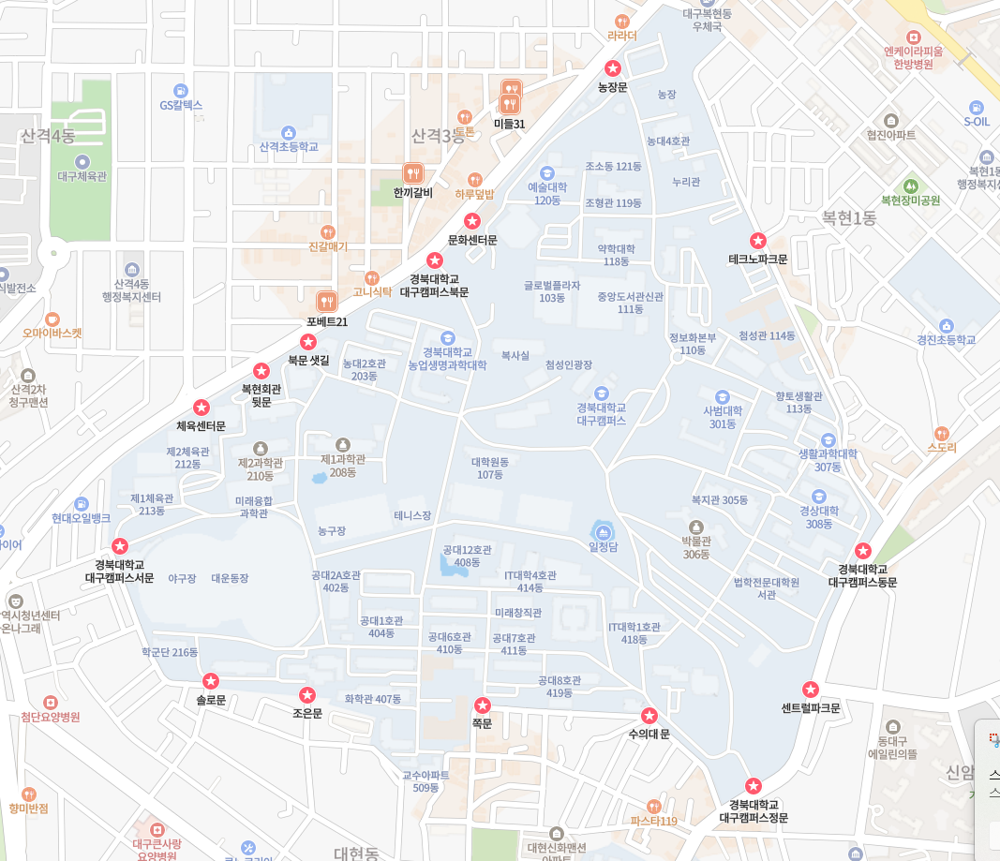
경북대학교 주요 출입구로는 경북대 정문, 쪽문, 조은문, 솔로문, 서문, 체육센터문, 복현회관 뒷문, 북문 샛길 문, 경대북문, 문화센터문, 농장문, 테크노문, 경대동문, 센트럴파크문, 수의대문이 있습니다.  
캠퍼스에 처음 방문할 때는 정문, 북문, 서문 등 지도에서 찾기 쉬운 출입구를 기준으로 이동하는 것이 편리합니다. 버스를 이용한다면 하차 정류장과 출입구의 위치를 함께 확인해야 합니다.
쪽문, 조은문, 솔로문 등 별칭으로 부르는 출입구는 지도 서비스에 같은 이름으로 표시되지 않을 수 있습니다. 이 가이드의 출입구 위치 사진과 주변 건물을 함께 확인하면 찾기 쉽습니다.
## 2. 단과대학별 위치 및 구역 안내
아래 지도는 경북대학교 대구캠퍼스의 단과대학과 주요 시설을 구역별로 표시한 개략도입니다. 방문할 목적지가 캠퍼스의 어느 쪽에 있는지 파악하는 데 활용할 수 있습니다.
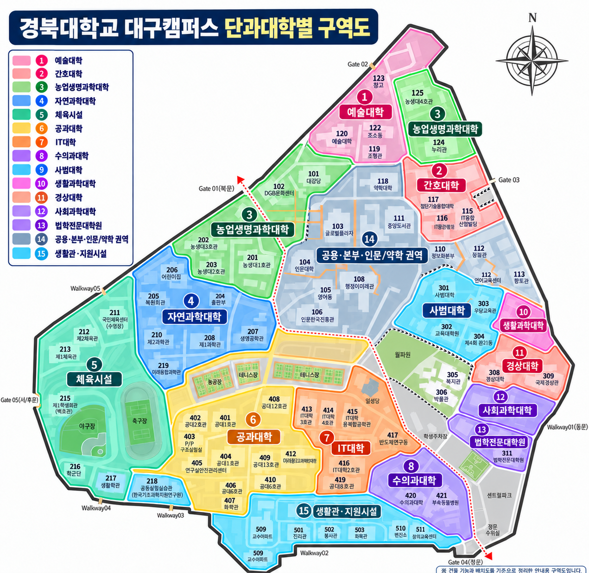
>※ 이 지도는 캠퍼스의 전체적인 배치를 이해하기 위한 개략도입니다. 색칠된 구역은 단과대학의 공식 경계나 모든 건물의 소속을 나타내지 않으며, 일부 공용시설과 다른 단과대학 건물이 포함될 수 있습니다.  

목적지별 출입구와 이동 경로는 4.목적지별 추천 이동 경로에서 안내합니다.

## 3. 주요 버스정류장 및 운행 노선

### 3.1 주요 버스정류장 위치
||||
|:---:|:---:|:---:|
|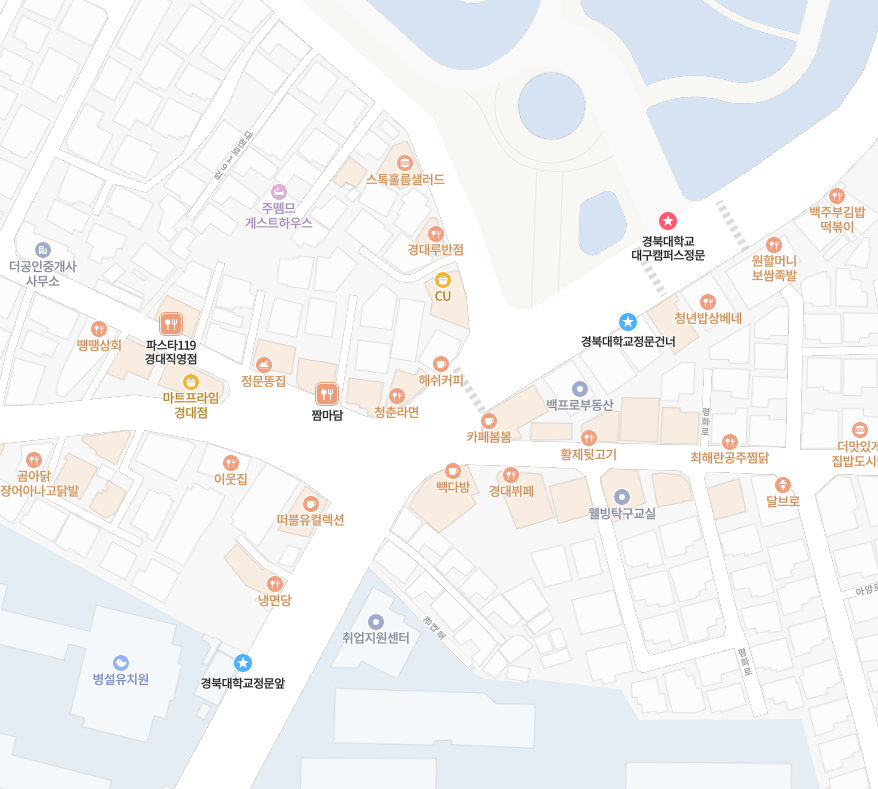|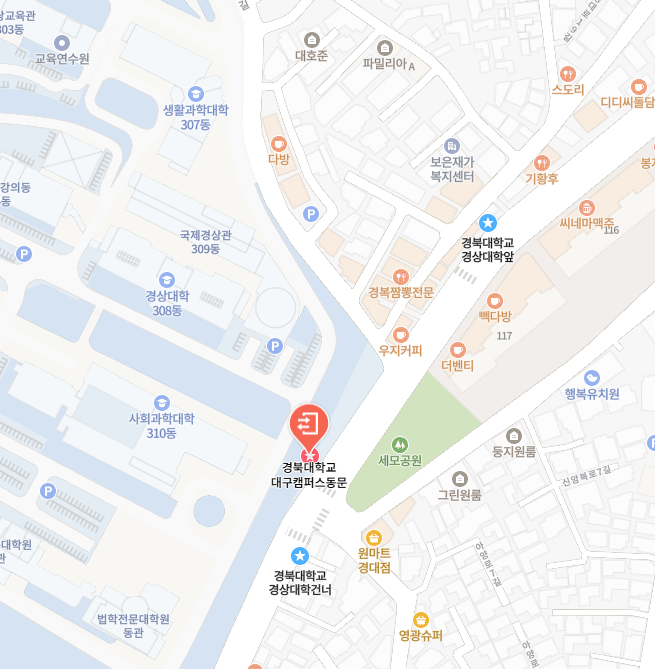|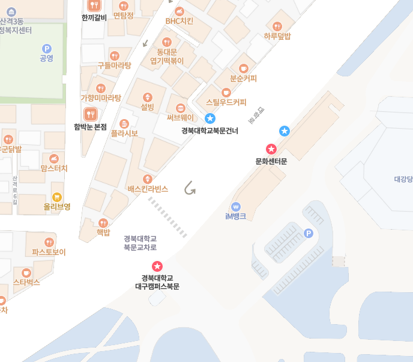|
|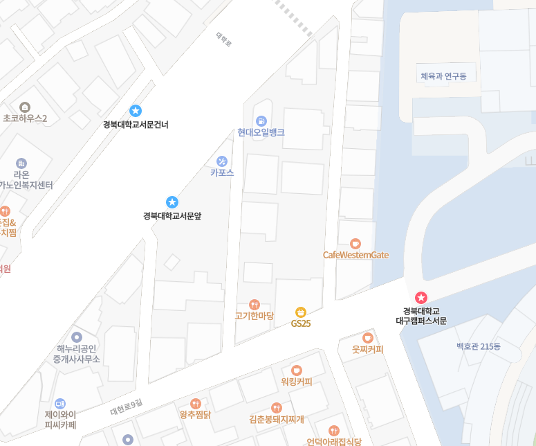|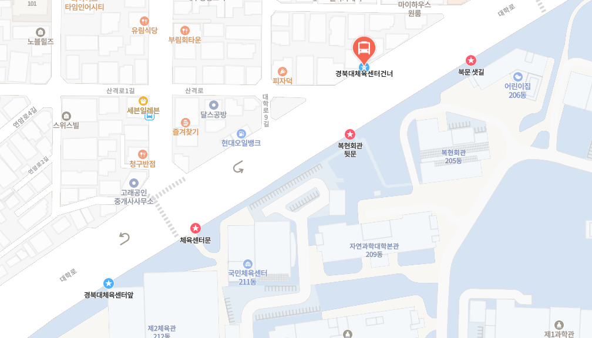|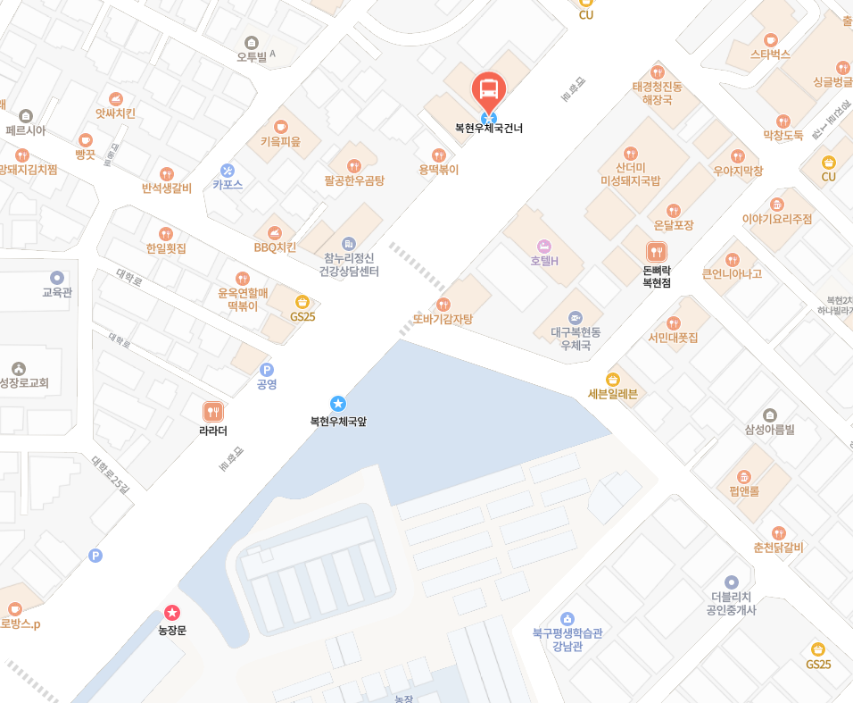  |

|장소|주요 정류장명|위치|
|:---:|:---:|:---:|
|정문 주변|경북대학교정문앞 / 경북대학교정문건너|동구 신암동 산 243-3/동구 신암동 705-15 정문 바깥 도로변에 위치한 정류장입니다. 정문을 기준으로 위치를 확인하면 됩니다.|
|북문 주변|경북대학교북문앞 / 경북대학교북문건너|북구 대학로 93 인근 — 해당 건물에서 약 32m로 안내/북구 대학로 93 인근 — 해당 건물에서 약 58m로 안내 북문 입구 주변 대학로에 위치합니다. 북문 상가 거리와 학교 입구를 기준으로 찾을 수 있습니다.|
|서문 주변 |경북대학교서문앞 / 경북대학교서문건너|북구 대학로 21-1/북구 산격동 1382-3 서문 인근 대학로에 위치합니다. 북구선거관리위원회 주변과 체육센터 사이 구간에 있습니다.|
|체육센터 주변|경북대체육센터앞 / 경북대체육센터건너|북구 대학로 23-1 인근 — 해당 건물에서 약 95m로 안내/북구 대학로 53 인근 — 해당 건물에서 약 18m로 안내 서문과 북문 사이, 체육센터 인근 대학로에 위치합니다.|
|농장문 주변|복현우체국앞 / 복현우체국건너|북구 대학로 129-2/북구 대학로 141 북문에서 복현오거리 방향으로 이어지는 대학로에 위치합니다.|
|경상대학 주변|경북대학교 경상대학앞 / 경북대학교 경상대학건너|북구 경진로 47/동구 신암동 1347-3 캠퍼스 동쪽 경상대학 인근 외곽 도로변에 위치합니다. 정문 정류장과 구분하여 확인해야 합니다.|

### 3.2 정류장별 운행 버스

| 구역 | 정류장명 | 운행 버스 |
|:---:|:---:|:---|
| 정문 주변 | 경북대학교정문앞 | 410, 503, 937, 북구2 |
| | 경북대학교정문건너 | 410-1, 503, 937, 북구2 |
| 북문 주변 | 경북대학교북문앞 | 300, 306, 410, 501, 523, 706, 719, 북구6 |
| | 경북대학교북문건너 | 300, 306, 410-1, 501, 523, 706, 719, 북구6 |
| 서문 주변 | 경북대학교서문앞 | 232, 300, 306, 410, 501, 523, 706, 719, 북구6 |
| | 경북대학교서문건너 | 232-1, 300, 306, 410-1, 501, 523, 706, 719, 북구6 |
| 체육센터 주변 | 경북대체육센터앞 | 300, 306, 410, 501, 523, 706, 719, 북구6 |
| | 경북대체육센터건너 | 300, 306, 410-1, 501, 523, 706, 719, 북구6 |
| 농장문 주변 | 복현우체국앞 | 300, 306, 410, 501, 523, 706, 719, 북구6 |
| | 복현우체국건너 | 300, 306, 410-1, 501, 523, 706, 719, 북구6 |
| 경상대학 주변 | 경북대학교 경상대학앞 | 410, 503, 937, 북구2 |
| | 경북대학교 경상대학건너 | 410-1, 503, 937, 북구2 |

> [상세 버스 노선정보는 여기를 클릭해주세요](https://businfo.daegu.go.kr/)  
> 클릭해서 원하는 버스 번호를 검색시 정보를 얻으실 수 있습니다.

## 4. 목적지별 추천 이동 경로

### 4.1 단과대학 방문
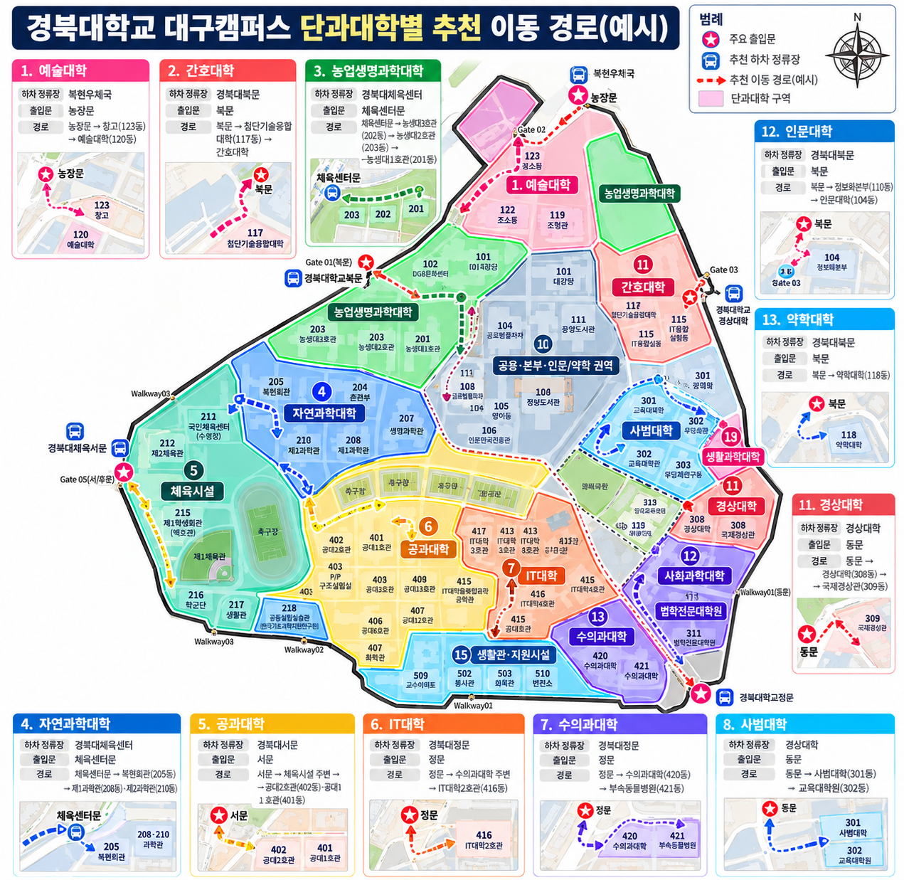

> [!WARNING]
> **이동 경로 안내사항**
>
> 본 지도에 표시된 이동 경로는 경북대학교 캠퍼스 내 건물 및 출입문 위치를 바탕으로 작성한 **예시 경로**입니다.
>
> 실제 최단 경로와 다를 수 있으며, 보행로 및 출입문 이용 상황에 따라 이동 경로가 달라질 수 있습니다. 따라서 **정확한 이동 경로는 현장 안내 및 지도 서비스를 통해 확인하시기 바랍니다.**

| 목적지 | 추천 하차 정류장 | 출입문 | 주요 경유 건물 및 이동 경로 |
|:---:|:---:|:---:|:---|
| 예술대학 | 복현우체국 | 농장문 | 농장문 → 창고(123동) 주변 → 예술대학(120동) |
| 간호대학 | 경북대학교북문 | 북문 | 북문 → 첨단기술융합대학(117동) 주변 → 간호대학 구역 |
| 농업생명과학대학 | 경북대체육센터 | 체육센터문 | 체육센터문 → 농생대3호관(202동) → 농생대2호관(203동) → 농생대1호관(201동) |
| 자연과학대학 | 경북대체육센터 | 체육센터문 | 체육센터문 → 복현회관(205동) 주변 → 제1과학관(208동)·제2과학관(210동) |
| 공과대학 | 경북대학교서문 | 서문 | 서문 → 체육시설 주변 → 공대2호관(402동)·공대1호관(401동) |
| IT대학 | 경북대학교정문 | 정문 | 정문 → 수의과대학 주변 → IT대학2호관(416동) → IT대학 구역 |
| 수의과대학 | 경북대학교정문 | 정문 | 정문 → 수의과대학(420동)·부속동물병원(421동) |
| 사범대학 | 경북대학교 경상대학 | 동문 | 동문 → 경상대학 북측 → 사범대학(301동)·교육대학원(302동) |
| 생활과학대학 | 경북대학교 경상대학 | 동문 | 동문 → 경상대학 북측 → 생활과학대학(307동) |
| 경상대학 | 경북대학교 경상대학 | 동문 | 동문 → 경상대학(308동)·국제경상관(309동) |
| 사회과학대학 | 경북대학교 경상대학 | 동문 | 동문 → 경상대학(308동) 주변 → 사회과학대학(310동) |
| 법학전문대학원 | 경북대학교 경상대학 | 동문 | 동문 → 경상대학 남측 → 법학전문대학원(311동) |
| 인문대학 | 경북대학교북문 | 북문 | 북문 → 정보화본부(110동) 주변 → 인문대학(104동) |
| 약학대학 | 경북대학교북문 | 북문 | 북문 → 간호대학 구역 주변 → 약학대학(118동) |

### 4.2 주요시설 방문
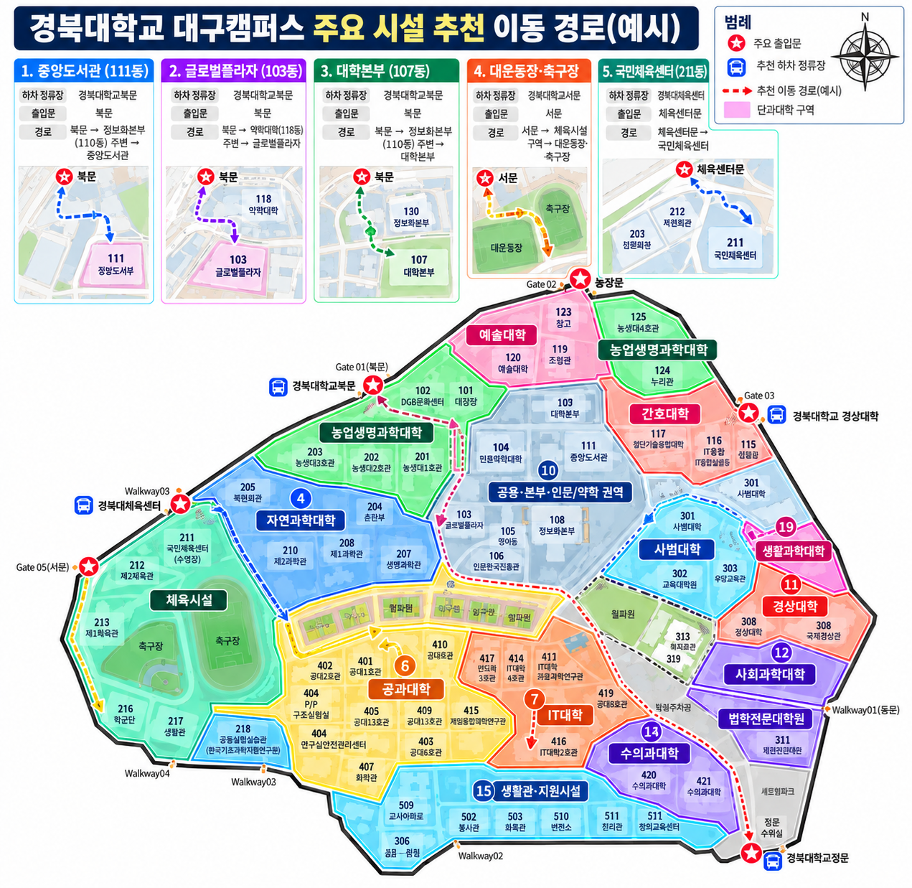  

| 주요 시설 | 추천 하차 정류장 | 출입문 | 추천 이동 경로 |
|:---:|:---:|:---:|:---|
| 중앙도서관(111동) | 경북대학교북문 | 북문 | 북문 → 정보화본부(110동) 주변 → 중앙도서관 |
| 글로벌플라자(103동) | 경북대학교북문 | 북문 | 북문 → 약학대학(118동) 주변 → 글로벌플라자 |
| 대학본부(107동) | 경북대학교북문 | 북문 | 북문 → 정보화본부(110동) 주변 → 대학본부 |
| 대운동장·축구장 | 경북대학교서문 | 서문 | 서문 → 체육시설 구역 → 대운동장·축구장 |
| 국민체육센터(211동) | 경북대체육센터 | 체육센터문 | 체육센터문 → 국민체육센터 |

### 4.3 건물별 대체 이동 경로  
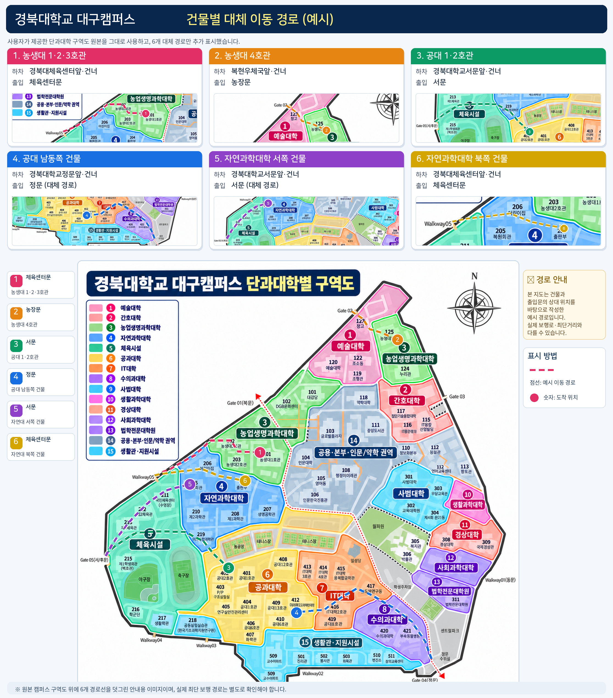 

| 목적 건물 | 추천 하차 정류장 | 이용 출입문 |
|:---:|:---:|:---:|
| 농생대 1·2·3호관 | 경북대체육센터앞·건너 | 체육센터문 |
| 농생대 4호관 | 복현우체국앞·건너 | 농장문 |
| 공대 1·2호관 | 경북대학교서문앞·건너 | 서문 |
| 공대 남동쪽 건물 | 경북대학교정문앞·건너 | 정문 (대체 경로) |
| 자연과학대학 서쪽 건물 | 경북대학교서문앞·건너 | 서문 (대체 경로) |
| 자연과학대학 북쪽 건물 | 경북대체육센터앞·건너 | 체육센터문 |

