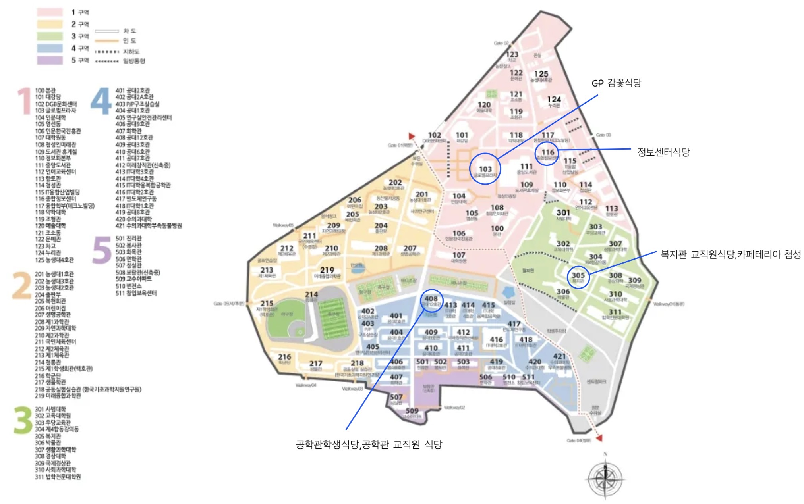

# 경북대학교 교내 식당 및 주변 맛집 안내

## 목차

### 1. 경북대학교 교내 식당
### 2. 경북대학교 주변 맛집
### 3. 식당 이용 참고사항

## 소개

경북대학교 신입생들이 교내 식당과 학교 주변 음식점을 편리하게 이용할 수 있도록 위치, 운영시간, 메뉴 및 가격 정보를 정리하였다. 메뉴와 가격, 영업시간은 변경될 수 있으므로 방문 전에 확인하는 것이 좋다.

## 1. 경북대학교 교내 식당

### 1-1. 공학관학생식당

- **위치:** 공대 12호관(408동) 1층
- **중식 운영시간:** 10:00~14:30
- **메뉴:** 한식, 덮밥, 찌개, 돈가스, 라면 등
- **참고:** 메뉴가 날마다 바뀝니다.

### 1-2. 공학관교직원식당

- **위치:** 공대 12호관(408동) 지하 1층
- **중식 운영시간:** 11:30~13:30
- **가격:** 6,000원
- **식사 형태:** 정식 배식

### 1-3. 복지관교직원식당

- **위치:** 복지관 내 교직원식당
- **중식 운영시간:** 11:15~13:30
- **가격:** 6,000원
- **식사 형태:** 정식 배식

### 1-4. GP감꽃식당

- **위치:** 글로벌플라자 3층
- **중식 운영시간:** 11:30~13:30
- **가격:** 6,000원
- **식사 형태:** 정식 배식

### 1-5. 정보센터식당

- **위치:** 종합정보센터 1층
- **중식 운영시간:** 11:00~13:30
- **메뉴:** 한식, 면류, 덮밥, 돈가스 등
- **참고:** 메뉴가 날마다 바뀝니다.

#### 상시 메뉴

| 메뉴 | 가격 |
|---|---:|
| 순살돈가스 | 4,500원 |
| 치즈돈가스 | 5,000원 |
| 고구마돈가스 | 5,000원 |
| 왕돈가스 | 6,000원 |
| 왕치즈돈가스 | 6,000원 |
| 라면 | 2,800원 |
| 우동 | 4,500원 |
| 우동밥 | 5,000원 |

### 1-6. 카페테리아 첨성

- **위치:** 복지관 학생동 1층
- **중식 운영시간:** 11:00~13:30
- **메뉴:** 한식, 국밥, 육회비빔밥 등
- **참고:** 메뉴가 날마다 바뀝니다.

#### 상시 메뉴

| 메뉴 | 가격 |
|---|---:|
| 순살돈가스 | 4,500원 |
| 치즈돈가스 | 5,000원 |
| 고구마돈가스 | 5,000원 |
| 왕돈가스 | 6,000원 |
| 치즈왕돈가스 | 6,000원 |

<경북대학교 교내 식당 위치 안내도>

## 2. 경북대학교 주변 맛집

### 2-1. 한식 — 고니식탁

- **주소:** 대구 북구 대학로 71, 2층
- **영업시간:** 11:00~21:00
- **브레이크타임:** 15:30~17:00

#### 메뉴 및 가격

| 메뉴 | 가격 |
|---|---:|
| 유자두루치기 | 11,000원 |
| 흑마늘 간장 불고기 | 11,000원 |
| 전라도 묵은지 김치찌개 | 10,500원 |
| 의성마늘 돼지찌개 | 10,500원 |
| 치즈계란말이 | 8,500원 |

- **참고:** 유자두루치기는 2인분 이상 주문해야 합니다.

### 2-2. 중식 — 마라용궁 경북대 본점

- **주소:** 대구 북구 대학로23길 33, 1층
- **영업시간:** 11:00~다음 날 01:00
- **라스트오더:** 00:00
- **메뉴:** 마라탕, 마라샹궈, 꿔바로우
- **가격:** 메뉴 및 선택한 재료에 따라 다릅니다.

### 2-3. 일식 — 마름모식당

- **주소:** 대구 북구 대동로6길 40, 2층
- **영업시간:** 10:30~20:30
- **라스트오더:** 20:00

#### 메뉴 및 가격

| 메뉴 | 가격 |
|---|---:|
| 간장돼지고기덮밥 | 9,500원 |
| 어향가지덮밥 | 10,500원 |
| 생연어덮밥 | 12,500원 |
| 연어장덮밥 | 13,500원 |
| 한우스테이크덮밥 | 12,500원 |
| 마름모 냉우동 | 6,900원 |
| 들기름우동 | 7,500원 |

